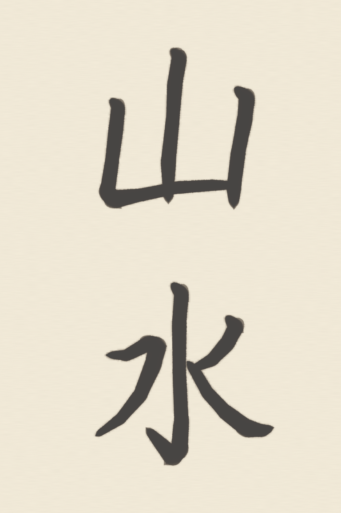
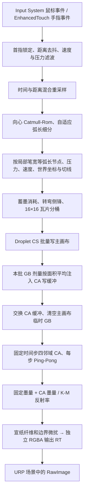

# Unity URP 实时毛笔书写原型

[下载 Windows 64 位运行包](https://github.com/txinner/realtime-ink-calligraphy/releases/download/v0.3.0/RealtimeInk-Windows-v0.3.zip)。解压整个 ZIP 后双击 `RealtimeInk.exe`。

<p align="center">
  
  <br>
  <sub>「山水」· 手工编排笔画轨迹，由本项目实时毛笔渲染</sub>
</p>

技术路线：**向心 Catmull–Rom 样条 → Droplet 水滴脚印 → 低分辨率 GPU 元胞自动机 → K–M 水墨复合**。

v0.3 新增 **逐笔撤销 / 重复（重做）/ 重写 / 透明 PNG 保存**，见 [笔画操作与导出说明](EDITING.md)。保留共用参数、六个可微调风格快照、三个独立笔法开关和 Windows 执行版，见 [分层参数说明](PARAMETERS.md)。六种预设不限制字形、不改变用户轨迹。

目标基线为 Unity **6000.3.7f1 / URP 17.3.0 / Input System 1.20.1**，只使用 Unity 官方包。Input System 版本按 [Unity 6000.3 已发布包文档](https://docs.unity.com/en-us/engine/6000.3/manual/packages-list/packages-all/pack-safe/com-unity-inputsystem)选择；旧模板中的 1.12.0 在此编辑器存在 ReservedCFE 编译问题。代码和演示工程均在本目录。60 FPS 是设计目标，实际帧率需要在目标设备、目标分辨率下测量；批处理验证不代表手机性能验收。

## 1. 整体架构与数据约定



每个批次最多 256 个脚印，每个 16×16 瓦片由一个 8×8 thread group 处理，每线程负责四个独立像素。正常书写时 CPU 上传路径节点、脚印和瓦片索引，同时记录可重放的笔画命令，没有逐像素绘制或 GPU readback；保存 PNG 和显式验证时才读回图像。

| 资源 | 默认大小 / 格式 | 通道含义 | 生命周期 |
|---|---|---|---|
| `PigmentCanvas` | 2048² / RGBAHalf | R：不移动的固定墨量；G：本批可扩散新墨；B：本批新水量；A：历史总剂量诊断 | 保留 R/A；每批注入后清 G/B |
| `state[2]` | 512² / RGHalf | R：CA 墨浓度；G：纸张累计吸附饱和度 | 注入和迭代均读一张、写另一张，再交换 |
| `wet[2]` | 512² / RFloat | 局部湿度，0 为干燥 | 和 state 同步 Ping-Pong；防止小蒸发量被 half 舍入吃掉 |
| `Output` | 2048² / RGBAHalf | 最终线性 RGB，A=1 | 每帧由当前墨量重新求值 |
| `ComputeBuffer` | 64 字节/脚印 | 四个 float4（含轮廓与噪声类型），另有瓦片 offset / index / active 数组 | 复用，超容量分批处理 |

默认 RT 显存约 **68 MiB**，不含缓冲、驱动开销和外部纸纹。降为主画布 1024² + CA 256² 后约 17 MiB。主画布或 CA 的 Half UAV 不受支持时自动选相应 Float RT，并切换匹配的 ComputeShader 类型变体，显存会增加。湿度固定为 RFloat，以保持低蒸发率的精度。

**为什么另加湿度 RT：**浓度与饱和度两个标量不足以同时表达“吸附上限”和“局部干燥历史”。饱和度单调增加，湿度随时间减少；饱和纸阻止流动，已有干墨冻结，空白干纸仍可吸墨。新脚印只润湿自己覆盖的位置。饱和度在本原型中是不可逆的有效吸附占用量，不是会随蒸发下降的瞬时含水率。这是书法手感用的经验 CA，并非流体或真实纸张化学模型。

## 2. 可调参数表

所有距离与速度使用**主画布 texel / texel·s⁻¹**，与屏幕窗口大小分开；把主画布分辨率减半时，笔半径、距离阈值、速度阈值、起收锋距离也应约减半，扩散系数约减至四分之一，才能保持相同 UV 视觉尺度。

### 分辨率与输入

| 字段 | 默认值 | 作用 / 调节建议 |
|---|---:|---|
| `canvasResolution` | 2048×2048 | 主画布与输出大小；分配参数，改后重新启用组件 |
| `diffusionResolution` | 512×512 | CA 大小；每维必须是主画布的 1/2～1/8 整数比例；至少 32 |
| `jitterDistance` | 0.65 px | 小于此位移不产生控制点；大了会损失细小顿挫 |
| `controlPointDistance` | 6 px | 距离重采样上限，减小提升急转弯精度 |
| `controlPointInterval` | 1/120 s | 时间重采样目标间隔；同时受最小位移限制 |
| `speedSmoothing` | 0.035 s | 速度低通时间常数；大了更稳但笔宽反应变迟 |
| `pressureSmoothing` | 0.025 s | 原生与虚拟压力的低通时间常数 |
| `speedForThinStroke` | 1500 px/s | 虚拟压力曲线的速度尺度，不是硬截断速度 |
| `minimumPressure` | 0.12 | 压力下限，防止快速划过时完全消失 |
| `virtualPressureExponent` | 1.25 | 速度→压力曲线的陡峭程度 |
| `touchPressure` | Auto | Auto：正 pressure 优先；VirtualOnly：强制速度；NativeTouch：强制原生并限制范围 |
| `nativePressureMaximum` | 1 | 原生 pressure 的归一化标定值 |
| `arcError` | 0.08 px | Catmull–Rom 弧线平展误差；越小 CPU 细分越多 |
| `arcChordLength` | 1 px | 弧长积分的小弦段长度上限 |

鼠标虚拟压力：`p = lerp(pMin, 1, 1 / (1 + (speed/speedScale)^exponent))`。

触屏使用 EnhancedTouch 事件，而不是在 Update 轮询低层 Touchscreen；Unity 文档提醒后者可能漏掉触摸状态变化。只锁定第一根开始书写的手指，其他手指不会接管当前笔画。[Unity Touch 文档](https://docs.unity3d.com/Packages/com.unity.inputsystem@1.11/manual/Touch.html)

部分触屏无压力能力却恒报 1，Input System 没有统一的压力能力检测接口；这种设备请手动选择 VirtualOnly。Auto 能回退缺失/零 pressure，不能从常数 1 推断硬件是否具备压感。原生 pressure 可能超过 1，本实现按 `nativePressureMaximum` 标定后限制到范围内。[Unity 迁移说明](https://github.com/Unity-Technologies/InputSystem/blob/develop/Packages/com.unity.inputsystem/Documentation~/corresponding-old-new-api.md)、[TouchState pressure](https://docs.unity.cn/Packages/com.unity.inputsystem@1.4/api/UnityEngine.InputSystem.LowLevel.TouchState.html)

### 笔刷、侧锋、蓄墨与飞白

| 字段 | 默认值 | 作用 / 调节建议 |
|---|---:|---|
| `minimumRadius` / `maximumRadius` | 2 / 22 px | 压力控制的半径；起收锋还会乘 taper |
| `pressureExponent` | 0.85 | 压力→半径映射，小于 1 更容易写粗 |
| `spacingFraction` | 0.18 | 局部笔宽的采样步长比例；建议 0.12～0.25 |
| `minimumSpacing` / `maximumSpacing` | 0.5 / 10 px | 步长限幅；细笔不要把最小步长设得比直径还大 |
| `dropletLength` | 1.85 | 常态沿切线方向的长轴倍率 |
| `sideLength` / `sideWidth` | 0.85 / 1.35 | 强转弯时纵向缩短、横向变宽，模拟侧锋 |
| `turnRateForSideBrush` | 600°/s | 达到完全侧锋的角速度 |
| `turnSmoothing` | 0.04 s | 转向形态滤波，抑制切线噪声导致的忽宽忽窄 |
| `startTaperLength` / `endTaperLength` | 18 / 14 px | 起锋与收锋距离；收锋只作用于最后未提交段 |
| `tipRadiusFraction` | 0.22 | 尖端半径比例；不要设为 0 |
| `pigmentLoad` | 1.4 | 每单位路径覆盖的颜料剂量，影响浓淡与叠墨 |
| `solubleFraction` | 0.22 | 可流动颜料上限；实际还乘剩墨²和速度因子 |
| `waterLoad` | 0.65 | 新墨含水量；增大会延长局部湿润、增强洇边 |
| `initialInk` | 1 | 启动/调用 RefillInk 后的笔头墨量 |
| `consumptionPer1000Pixels` | 0.20 | 每千像素的耗墨尺度，还受笔宽及剩墨非线性影响 |
| `refillPerSecond` / `refillDelay` | 0.07 / 0.5 s | 抬笔静置后逐渐回墨，按住不动不回墨 |
| `noiseStrength` | 0.8 | 飞白与轮廓噪声上限；剩墨低、速度高时增加 |
| `noiseFrequency` | 0.12 px⁻¹ | Perlin 频率；沿切线低频、横向高频形成纤维状留白 |

水滴局部坐标中 x 沿切线，后半部使用 `sqrt(1-x²)` 的圆弧，前半部使用 `cos(πx/2)^1.12` 的渐尖轮廓；它前后不对称，**不是把椭圆旋转后当成水滴**。按下立即绘制一个较小的水滴起笔点；首个有方向的节点随后使用实际切线。单次点击形成小顿笔。

`representedLength` 记录每个脚印代表的弧长。颜料剂量按 `length/(2*radius)` 积分，耗墨按 `length * (radius/maxRadius)^1.2 * (0.35+0.65*ink²)` 积分；增加采样密度不会线性增加耗墨或叠墨。采样仍是有限分辨率近似，抗锯齿、曲率和 taper 会带来小幅离散误差。

### 洇墨、干燥与显示

| 字段 | 默认值 | 作用 / 调节建议 |
|---|---:|---|
| `inkDiffusion` | 42 px²/s | 墨扩散系数；建议先在 15～80 调整 |
| `waterDiffusion` | 85 px²/s | 水分传输尺度，通常大于墨 |
| `saturationLimit` | 1 | 饱和上限，降低会更快阻止洇开 |
| `saturationFromDeposit` | 0.12 | 落墨水量对纸张饱和度的增加 |
| `saturationFromInflux` | 0.5 | 邻域流入墨量造成的吸附占用 |
| `absorptionRate` | 0.10 /s | 湿润时局部吸附增长速度 |
| `dryingRate` | 0.65 /s | 湿度线性消耗，越大越快冻结；局部湿度上限 1 |
| `freezeWetness` | 0.008 | 低于此值把湿度精确归零，避免渐近漂移 |
| `anisotropy` | 0.45 | 纤维方向偏好，0 为无方向偏好 |
| `fiberAngle` | 15° | 纸纤维的主要方向 |
| `fiberRandomness` | 0.22 | 固定空间随机边导通系数，不随帧闪动 |
| `simulationHz` | 60 | 目标 CA 固定频率，允许与显示帧率不同 |
| `maximumSubsteps` | 4 | 每帧最大 CA 步数，防止卡顿后无限追帧 |
| `paperColor` | (0.94,0.91,0.83) | 纸底色，在 shader 内用线性反射率 |
| `paperFiberTexture` | 空 | 可选灰度宣纸数据；为空时仍有 GPU 程序纤维 |
| `paperTextureTiling` / `paperTextureStrength` | 4 / 0.075 | 纹理平铺和底色起伏强度 |
| `edgeWarpPixels` | 0.45 px | 墨边采样 UV 微扰，过大会出现锯齿或位置偏差 |
| `inkAbsorption` | (2.4,2.6,2.8) | K–M 吸收系数 RGB，控制墨色与深度 |
| `inkScattering` | 0.35 | K–M 散射系数，增大使厚墨更亮、更浑浊 |
| `diffusionVisibility` | 1 | 显示阶段 CA 墨量倍率；设 0 方便只检查主笔画 |
| `debugView` | Composite | Composite / FixedPigment / DiffusedPigment / Saturation / Wetness |

## 3. 关键实现

### 输入、样条与节点

- `Runtime/RealtimeInkCanvas.cs`：鼠标 InputAction、EnhancedTouch 事件、首指锁定、UV/世界坐标映射、失焦/越界处理、蓄墨、RT 管理与每帧调度。
- `Runtime/InkPathSampler.cs`：预处理、时间距离重采样、向心 Catmull–Rom、自适应曲线平展、跨段弧长游标、起收锋和端点补齐。
- `Runtime/InkSettings.cs`：Inspector 参数分组、压力模式、调试模式。
- `Runtime/InkTileBatch.cs`：16×16 瓦片的压缩索引表、每批最多 256 个脚印，溢出继续下一批，不丢节点。

`InkPathNode` 包含：`worldPosition`、`worldTangent`、`canvasPosition`、`canvasTangent`、`pressure`、`speed`、`time`、`radius`、`arcLength` 和 `representedLength`。可订阅 `PathNodeGenerated` 做轨迹调试。这里的世界坐标来自 RawImage 所在 Canvas；World Space Canvas 会给出实际三维纸面坐标，Overlay Canvas 的坐标则是 UI 的世界空间。

向心 Catmull–Rom 需要一个控制点前瞻，存在一个控制点的延迟。起笔小脚印立即显示；抬笔将最后一个真实段用镜像端点补齐。不会为了预览反复向永久画布重画同一段。最后段长度不足 `endTaperLength` 时，收锋会压缩到该段；希望极长提锋时，可通过真实 pressure 的变化或扩大控制点间距实现，不会伪造超出抬笔位置的尾巴。

### 两个 ComputeShader

`Shaders/DropletBrush.compute` 有两个 kernel：

1. `DrawDroplets`：独占像素线程，按瓦片索引顺序累积水滴颜料/水量；轮廓与透明度受 gradient Perlin 干笔噪声扰动。
2. `ClearPending`：只清活跃瓦片的临时 G/B，不触碰固定墨量 R。

`Shaders/InkDiffusion.compute` 有两个 kernel：

1. `InjectNewInk`：在整张小 RT 上读取旧 CA 状态与主画布新剂量，面积平均后写另一张 RT；未覆盖区域也复制，防止出现未初始化数据。
2. `IterateCA`：上下左右四邻域通量，局部吸附和蒸发；只读 `Read`，只写 `Write`。

对相邻像素 i、j，墨通量近似为：

```text
F(i←j) = D * dt / h_axis² * edge(i,j) * wet_donor * (Cj - Ci)
edge(i,j) = min(permeability_i, permeability_j) * fiber_edge
permeability = (1 - saturation/saturationLimit)²
```

`fiber_edge` 由无向边坐标生成，`edge(i,j)=edge(j,i)`，避免独立随机数造成凭空增减墨量。饱和格或已有墨的干燥格将 permeability 置零，纸边采用无通量边界。只对**水**蒸发，不对颜料做指数衰减，所以干墨不会消失。CA 默认使用 Half 存储，存在量化误差；总浓度 64 为保护上限，触及上限后不再严格守恒。

C# 将每轴系数限制到不超过 0.24，保证显式四邻域更新的非负稳定性。高扩散系数会自动缩小 dt；若一帧步数预算不足，丢弃过多的积压时间，视觉表现为扩散和干燥变慢，不会用超大 dt 引爆模拟。模拟休眠根据**实际迭代累计的蒸发量**判定；即使在书写中途调整 dryingRate，也不会提前休眠。

### 最终 K–M 复合 Shader

`Shaders/InkComposite.shader` 由 `Graphics.Blit` 写独立 Output RT，RawImage 在 URP 中显示。无需 `OnRenderImage`，不依赖 RenderGraph/RendererFeature 的版本接口。

先求 `M = fixedPigment + diffusionPigment * visibility`，再使用单种颜料有限厚度 K–M 双通量近似：

```text
a = 1 + K/S
b = sqrt(a² - 1)
x = b*S*M
e = exp(-2*x)
den = a*(1-e) + b*(1+e)
R = (1-e)/den
T = 2*b*exp(-x)/den
result = R + T² * paperReflectance / (1 - R*paperReflectance)
```

M=0 时结果等于纸底；叠写增加 M 后颜色渐深并趋向厚墨极限。公式用负指数避免 sinh/cosh 溢出。它是同一种黑色颜料的厚度叠加，不是多颜料光谱混色，也不是 `lerp(paper, black, alpha)`。水彩渲染中采用 K–M 光学复合的原始研究可见 [Curtis 等，Computer-Generated Watercolor](https://grail.cs.washington.edu/wp-content/uploads/2015/08/curtis-1997-cgw.pdf)。

**不把复合颜色反写进颜料历史。** Shader 每帧只读当前物质量和固定纸纹，避免把同一份 CA 墨量每帧再混一次造成“越放越黑”。Shader Pass 使用 `Blend Off`，显示输出 A=1。

## 4. 导入与首次调试

1. 用 Unity Hub 打开本目录作为完整 Unity 工程；已有工程可复制 `Assets/RealtimeInk`，或通过 Unity 菜单 **Tools → Realtime Ink → Export Source Package** 生成导入包。
2. 通过 Unity Package Manager 安装对应版本的 **Universal RP、Input System、Unity UI**。现有项目无需覆盖本工程的 `Packages/manifest.json`。
3. Project Settings → Player：Color Space 设为 **Linear**；Active Input Handling 设为 **Input System Package (New)** 或 **Both**，按 Unity 提示重启。Input System 更新模式使用 **Process Events In Dynamic Update**。
4. 打开附带的 `Assets/RealtimeInk/Demo/InkDemo.unity`，或菜单 **Tools → Realtime Ink → Create Demo Scene**。后者创建新场景，并在原项目没有 SRP 时建立演示 URP 配置；不会替换已有 URP 管线。如果当前存在尚未命名的场景，工具先把它完整保存到 Demo 下唯一命名的 PreservedScene 文件，再添加演示场景。
5. Play，在纸上按住鼠标或用第一根手指书写。`C` 清纸，`R` 蘸墨，`D` 循环调试通道。触屏端可把 UI Button 的 OnClick 绑定到公开方法 `ClearCanvas()` 和 `RefillInk()`。
6. 选中 `Realtime Ink` 对象，在 Inspector 中调 input / brush / paper / appearance。分辨率修改后先禁用再启用组件，此操作会重建并清空 RT。

手动装配时：创建 Canvas 和 RawImage，把 `RealtimeInkCanvas` 挂在任意对象上，分别拖入两个 `.compute`、`InkComposite.shader` 和 RawImage。`RawImage.uvRect` 必须为 `(0,0,1,1)`，Color 应保持白色不透明；纸面纵横比应与主 RT 一致。World Space / Screen Space Camera Canvas 必须设置 Canvas 的 `worldCamera`。输入从纸外按下再移入不会开始书写，已有笔画移出纸面会在最后有效点收笔。

自定义纸纹导入：Texture Type=Default，**sRGB 关闭**（当作数据），Wrap Mode=Repeat；无需 Read/Write Enabled。默认没有外部纹理依赖，程序纤维可直接运行。要让自定义纸纹也决定 CA 导通，可以将同一纸纹加入 `EdgeFiber`；当前 CA 和显示纹理各自有稳定纤维场。

GPU 必须支持 ComputeShader 和所用 UAV 格式；优先测试 DX11/DX12、Metal、Vulkan。WebGL 不属于此 ComputeShader 方案的目标。跨 API 时，RWTexture 的 HLSL 类型必须和 RT 格式一致；本实现为 Half 与 Float 各提供匹配变体。[Unity ComputeShader 跨平台说明](https://docs.unity.cn/6000.0/Documentation/Manual/class-ComputeShader.html)

## 5. Inspector 调试顺序与纸墨调参示例

先把 `diffusionVisibility=0`、`noiseStrength=0`，只调半径、虚拟压力和间距；确认细线、转弯与高速长划连续后，再恢复噪声和洇墨。用 D 切到 Wetness 检查局部归零，再看 Saturation 的阻流区域，最后调 K/S 和纸纹。

| 目标 | 参数起点 |
|---|---|
| 熟宣/工整小字 | solubleFraction=0.08，inkDiffusion=15，dryingRate=1.2，noiseStrength=0.4 |
| 默认行书 | 保持默认；先按鼠标移动习惯调 speedForThinStroke |
| 湿润生宣 | solubleFraction=0.3，waterLoad=0.9，inkDiffusion=65，dryingRate=0.4 |
| 飞白枯笔 | initialInk=0.25 后调用 RefillInk，noiseStrength=1，solubleFraction=0.1 |

这些是原型调参起点，不是经过纸墨样本标定的物理参数。松鼠标自动回墨是交互便利功能；要持续写到枯笔，可将 refillPerSecond=0，手动按 R 蘸墨。

## 6. 性能建议

- 默认单指、单画布。脚印绘制只 dispatch 活跃瓦片，不对每个脚印 dispatch 整张 2048² RT；大批次拆分不会丢点。
- CA 只在 512² 上跑；注入时每个主像素读取一次，使用整数面积平均，不为每个低分辨率像素遍历全部脚印。
- 手机优先 1024² / 256²，CA 30 Hz、maximumSubsteps=2，按前述规则缩放像素单位参数。1440p/4K 输出应单独评估复合带宽和噪声成本。
- 墨迹完全干燥后 CA 自动休眠；复合仍每帧运行，以便 Inspector 颜色/调试选项立即更新。产品化时可以给最终复合加 dirty 标记，或把纸纹预烘到 GPU RT。
- 所有运行时 shader 运算为 GPU；C# 不读回 RT。List/Queue/ComputeBuffer 复用，异常长事件队列或瓦片索引首次扩容可能产生一次分配。
- shader 尺寸数组也缓存复用，避免 SetInts 的 params 接口在每帧生成短数组。
- 使用 Profiler 的 `Ink.InputAndSpline` 与 `Ink.GPUSchedule` 标记检查 CPU 提交；GPU 时间请用 GPU Profiler/Frame Debugger。CPU 提交耗时不等于 GPU 完成耗时。
- 当前在默认 graphics queue 上顺序提交，保证 Draw → Inject → Clear → CA → Composite 依赖；如果未来移入 async compute，必须补 GraphicsFence/RenderGraph 资源依赖。
- 单笔控制点只保留四个，弧长游标跨段延续。逐笔撤销/重做记录的是脚印和 CA 命令，保存导出的是透明 PNG；当前版本不包含可重新打开的笔画工程格式。

## 7. 常见 bug 排查

| 现象 | 常见原因 | 本实现处理 / 调整位置 |
|---|---|---|
| 快速划线断线 | 按帧仅画一个脚印、步长超过窄轴、单帧节点被截断 | 弧长重采样 + 局部半径步长 + 批次完整消费；调小 spacingFraction |
| 脚印结块、调密度后变黑 | 固定每脚印剂量；停笔重复写同一点 | 剂量按 representedLength 归一；重复位置不落墨 |
| 弧线抖动/急转出环 | 原始采样太密、均匀 Catmull 对非均匀点过冲 | 距离去抖 + 向心 Catmull；再调 speed/pressure/turn 平滑 |
| 所有触屏笔画一样粗 | 无压力设备恒报 pressure=1 | touchPressure 切 VirtualOnly |
| 多指出现长直跳线 | primaryTouch 改变身份或直接接续另一根手指 | 首指 ID 锁定，第二根手指不能接管 |
| 笔尖拖后一点 | Catmull–Rom 前瞻、压力滤波延迟 | 控制点间距/时间间隔适当减小；不重新覆盖已提交曲线 |
| 抬笔末尾缺一段 | 最后控制点没 flush；尾端不足一步被丢弃 | End 镜像外推 + 最后残余弧长补齐 |
| 越界/失焦后画出跨纸长线 | 上一笔状态未结束 | 越界与失焦在最后有效点收笔，下次需重新按下 |
| CA 条纹/闪烁/NaN | 原地邻居读写、越界、步长过大 | 两组严格 Ping-Pong、边界检查、每轴系数≤0.24 |
| 洇墨过度、整笔糊成灰块 | solubleFraction / waterLoad / D 太高，干燥太慢 | 降低可流动比例与扩散，增大 dryingRate；保留主画布固定墨 |
| 空白纸不吸墨 | 把 wet=0 当成所有格子的阻流条件 | 只有已有墨且干燥的格子冻结，空白纸可接受流入 |
| 墨迹静止后继续变黑 | 旧注入没清、复合颜色被反馈、反复 alpha 混合 | G/B 每批清零；颜色输出与墨量 RT 分离 |
| 新笔画让旧墨重新动起来 | 使用整张纸的全局干燥时间 | 单独局部 wet Ping-Pong，只在落墨范围润湿 |
| 同一参数换 CA 分辨率就大幅改变洇边 | D 没按格子大小转换 | 使用主画布 px²/s，除以 h_axis²；仍会有离散精度差异 |
| PC 可用、Vulkan 黑屏 | UAV 格式与 RWTexture 类型不匹配 | Half/Float 关键字变体与自动格式检测；查看初始化报错 |
| 画面粉色/没有输入 | URP/依赖未安装，Active Input Handling 错误 | 检查包、URP asset、Linear 与 Input System 设置 |
| 点击位置和墨迹错位 | uvRect 裁切/镜像、Canvas camera 缺失、纸面非等比缩放 | 保持 uvRect 默认、设置 worldCamera、对齐画布纵横比 |
| 多次进入 Play 后显存增加 | RT/Buffer/事件未释放 | OnDisable 清理实例 RT、Buffer、材质、InputAction 和 EnhancedTouch 引用 |

## 8. 验证入口

菜单 **Tools → Realtime Ink → Run Validation** 执行样条、端点、单击、去抖、长停顿、GPU 墨量、临时通道清空、干燥休眠、局部复湿、饱和阻流和叠墨变暗检查，输出 `Validation/results.txt` 和 `Validation/ink-preview.png`。GPU 验证需要图形设备，不能用 `-nographics`。

本原型不实现笔毛物理、LiquidFun、溅墨粒子、AI 字形或笔迹识别。最终笔画完全由用户的实时鼠标/触摸轨迹决定。
